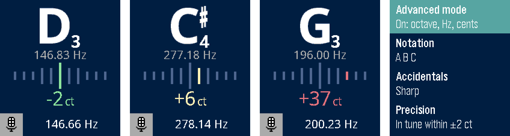
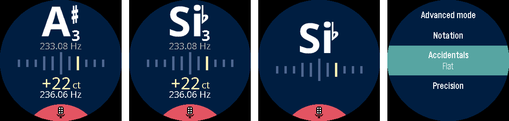

# guitar-tuner

A chromatic tuner for Pebble watches, modelled on
[Chroma](https://github.com/adrielcafe/chroma). The watch listens through its
own microphone and does all the pitch detection on the watch, so the phone
isn't involved once the app is installed.





## Watches

| Watch | Platform | Screen |
| --- | --- | --- |
| Pebble Time 2 | `emery` | 200×228 colour |
| Pebble Round 2 | `gabbro` | 260×260 round colour |

The app uses the local microphone capture API (`mic_capture_start`, SDK
revision 111, firmware and SDK 4.44 or later). Older watches can't capture
audio in apps: their SDKs are frozen and stub the API out.

### Microphone permission

The app declares `WatchMicrophone` in `package.json`. To grant it, open the
app's page in the Pebble phone app, with its experimental permission system
turned on, and allow Microphone. The grant is synced to the watch and stays
there, so the tuner works without the phone after that. Until the grant
arrives, the watch shows "Allow the microphone for Tuner in the Pebble app."

## Using it

Open the app and play a note. The screen shows:

- the nearest note, with its accidental and octave
- that note's exact frequency
- a row of 11 bars: green means in tune, yellow is under 30 cents off, and
  red is further off. Bars on the left mean flat, on the right sharp.
- the deviation in cents, and the frequency it heard. On the Time 2 this
  appears next to the Listening indicator.

After the string stops ringing, the last reading stays on screen in grey for
about a second.

Press **Select** for settings. The first four match Chroma's options and
defaults:

| Setting | Options | Default |
| --- | --- | --- |
| Advanced mode | On (octave, Hz, cents) / Off (note and bars only) | On |
| Notation | A B C / Do Re Mi | A B C |
| Accidentals | Sharp / Flat | Sharp |
| Precision | in tune within ±0 … ±5 cents | ±2 |
| Sensitivity | Low (noisy rooms) / Normal / High (soft playing) | Normal |

Sensitivity sets how quiet and how noisy a note can be and still show. Each
step up picks up quieter plucks and keeps a ringing note on screen longer. In
the tests, a pluck 24 dB down stays on screen 0.62 s at Low, 0.73 s at Normal
and 0.82 s at High. The cost is that readings in a note's noisy tail wander a
little more. Low is the original tuning.

The detection range is 58–1400 Hz. That covers a 7-string low B up to the
24th fret of the high E string.

## How it works

All the audio code is portable C99 in `src/c/pitch.c` and `src/c/tuner.c`, so
it can be tested on a desktop. Pebble apps are built for Cortex-M3 with
software floating point, so the heavy loops use integer maths only.

1. **Pre-filter.** A ~38 Hz rumble blocker and a two-pole ~1.8 kHz low-pass,
   in fixed point, as samples arrive (16 kHz, 20 ms frames).
2. **Coarse period.** Every 40 ms, the latest 64 ms is decimated to 8 kHz and
   run through [YIN](http://audition.ens.fr/adc/pdf/2002_JASA_YIN.pdf): the
   difference function, cumulative-mean normalisation, and the first dip
   under the threshold, read from a parabola through that dip. If that dip
   is a strong 2nd harmonic, the detector drops an octave. This happens with
   a weak fundamental, for example a low string through a small microphone.
3. **Rumble check.** Plucking an acoustic guitar hard sets its body ringing
   at the air resonance, around 90–130 Hz, for a fraction of a second. High
   E plus a 110 Hz thump repeats every three E periods, so within one window
   it looks exactly like an A2 note. The difference is that a real A2 string
   also has partials at 220, 440, 550 Hz and so on. So when the detector
   picks a long period, it checks a bass-attenuated copy of the signal (a
   second difference, +12 dB per octave). If that copy is cleanly periodic
   at 1/2 … 1/5 of the period, the long period came from the thump, and the
   shorter one is the string.
4. **Precise period.** The raw difference function is evaluated again at
   16 kHz on the few lags around that period. The window covers up to 128 ms
   of audio since the note started. A cosine fit through the minimum gives
   accuracy well under a cent.
5. **Display.** A median of three readings rejects outliers. Smoothing is
   weighted by how periodic each window is, so a decaying note settles
   instead of wandering. A note change needs one clean reading, or two
   agreeing ones at the more sensitive levels, to take effect.
   There is hysteresis at ±50 cents, and the reading is held for 0.8 s after
   the sound stops.

Each estimate costs about 65k multiply-accumulates and uses about 8 KB of RAM.

## Building

Install the [Pebble SDK](https://developer.repebble.com/sdk/), then:

```sh
pebble build
pebble install --emulator emery     # or gabbro, or --phone <ip>
```

In the emulator, the phone simulator grants the microphone to the app
automatically. You can feed it a test note:

```sh
python3 tools/pluck_wav.py E2 -12 /tmp/e2.wav    # E2, 12 cents flat
python3 tools/pluck_wav.py E4 0 /tmp/e4.wav --thump 110    # hard pluck, body thump
python3 tools/pluck_wav.py A2 0 /tmp/a2.wav --peak 0.01 --noise 0.001   # soft
pebble emu-mic --emulator emery --file /tmp/e2.wav
pebble emu-mic --emulator emery --tone 440       # or a plain sine
```

## Tests

```sh
make -C test
```

The host tests feed synthetic audio through the tuner exactly as the watch
does: 320-sample frames into `tuner_feed`. The cases are:

- sine sweeps
- plucked strings from B1 to E6
- low strings through two simulated small-microphone high-pass filters
- notes at 10 dB SNR (the noisy cases run under four noise seeds)
- plucks with a guitar-body thump at the attack
- white noise and silence
- soft plucks over a noise floor
- cents offsets
- note changes, hold and release

The robustness tests run at every sensitivity. On clean plucks, every reading
is within 0.5 cents. In the noisy and filtered cases the mean error is
0.3–1.4 cents at Low and up to about 2.3 cents at High. No stress test ever
shows a wrong note. With a body thump as loud as the string, high E never
reads wrong (it used to read A2 for up to 0.8 s), and the other strings are
right in at least 98% of readings.

## Project layout

```
src/c/main.c        app lifecycle, mic capture, start-up animation
src/c/ui.c          tuner screen
src/c/settings.c    settings, persisted on the watch, and their menu
src/c/tuner.c       streaming pre-filter, smoothing, note logic   (portable)
src/c/pitch.c       YIN pitch detector                            (portable)
src/c/notes.c       note names, cents, log2                       (portable)
resources/glyphs/   pre-rendered note names (tools/render_glyphs.py)
test/               host tests
tools/              glyph renderer, test WAV generator
```

Pebble font glyphs are 1-bit and capped at 4096 pixels, which is too small
for a Chroma-sized letter. Instead, the big note names and ♯/♭ are
pre-rendered as anti-aliased images by `tools/render_glyphs.py`. After
changing their sizes, rerun the script and update `NOTE_CAP` in `src/c/ui.c`.

## Credits

- Design after [Chroma](https://github.com/adrielcafe/chroma) by Adriel Café
  (MIT). No code or assets are copied from it.
- [Noto Sans](https://github.com/notofonts/latin-greek-cyrillic) and
  [Noto Music](https://github.com/notofonts/music), under the SIL Open Font
  License (`resources/fonts/OFL-*.txt`).
